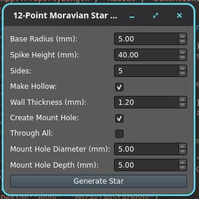

A FreeCAD macro that creates a Moravian Star.  It is a 12 point version of the star that is hollow, hopefully to be able to 3D print the thing.

All of the code was by myself and Google Gemini, I might be a software engineer but I don't pretend to be a mathematician. 
The macro starts with a dialog box asking for parameters:

The parameters are close estimates in that this is a 12 point star, at which point do you measure from? 

This is the star with the default parameters:

It was written using FreeCAD 26.3 RC2 but I don't think I used anything that would restrict it from another version.
